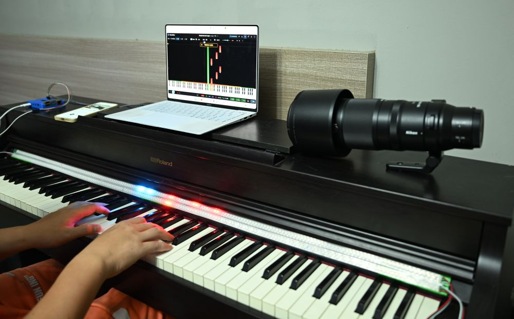

<p align="center">
  
</p>

<h1 align="center">Piayes · 派亚</h1>

<p align="center">
  浏览器里的钢琴跟弹练习 —— 乐谱下落、实时判定、LED 灯带指引
</p>

<p align="center">
  <b>在线试用 → <a href="https://piano.loveinshare.tech">https://piano.loveinshare.tech</a></b>
</p>

<p align="center">
  <a href="https://github.com/YOUR_ACCOUNT/piayes/actions/workflows/ci.yml"></a>
  
  
</p>

---

## 摘要

**Piayes** 是一款跑在浏览器里的**钢琴跟弹练习**工具。把 MIDI / MusicXML 乐谱渲染成从屏幕上方下落的音符，你跟着弹，程序实时判定命中、准不准、有没有漏；还能用 **LED 灯带**（ESP32 蓝牙 或 树莓派）在琴键旁亮出下一个该按的键。支持左右手分练、速度调节、容差微调、节拍器、计分统计，以及账号 + 私有谱子库。不用电钢也能弹 —— 内置钢琴采样自己发声。

<p align="center">
  
</p>

## Summary

**Piayes** is a **piano follow-along trainer** that runs entirely in the browser. It renders MIDI / MusicXML scores as notes falling from the top of the screen; while you play, it judges every keystroke in real time — hit, accuracy, missed notes — and can light up the **next key to press** on an **LED strip** (ESP32 over Bluetooth, or a Raspberry Pi over WebSocket). It supports separate left/right-hand practice, tempo scaling, tolerance tuning, a metronome, score statistics, and accounts with a private score library. No electric piano required: built-in piano samples play the backing track for you.

---

# 中文

## 功能

- **下落乐谱**：MIDI / MusicXML (.mxl) 解析后渲染成五线谱 + 下落音符，钢琴键位高亮。
- **实时判定**：命中 / 漏音 / 错音分级统计（Perfect / Good / Miss / Error），连击与最高连击。
- **容差可调**：判定窗口 30–300 ms，按自己的手感调；错音会告诉你弹错了哪个键。
- **左右手分练**：左手 / 右手 / 双手，随时切换，判定只算当前这一只手。
- **抢先模式**：音符到达判定线前就亮灯（跟灯带同步），适合视奏。
- **速度调节**：0.25×–1.5× 变速练习；节拍器可独立开关。
- **LED 灯带**：ESP32-S3（蓝牙）或树莓派（WebSocket）两种后端，左右手可分开开关，支持多套配色方案。
- **内置音色**：Salamander Grand Piano v3 采样，A0–C8 覆盖，不接电钢也有钢琴声。
- **账号 + 私有谱库**：注册后拖入的 .mid / .mxl 自动存到「我的谱子」，随时加载、删除。
- **配置跟着账号走**：灯带 IP、亮度、配色、容差等前端配置本地存一份，登录后账号里也存一份，换设备自动同步。
- **谱面编辑器**：改音符、调速度、改拍号，导出 .mid / .musicxml / .mxl。

## 快速开始

```bash
npm install
npm run dev:all   # 前端 5173 + 后端 API 8131（vite 把 /api 代理过去）
```

打开 http://127.0.0.1:5173 ，点右上角的「乐库」选一首，或直接把 `.mid` / `.mxl` 拖进页面。

> 不想自己装？直接打开 <https://piano.loveinshare.tech> 就是线上版本，可以先试试手感。

> `npm run dev` 只起前端 —— 登录 / 上传 / 私有谱子全在 `/api` 上，后端不起就是 404。
> 要试账号功能请用 `dev:all`（Windows 下也可以双击 `start-dev.bat`）。

其他常用命令：

```bash
npm test           # vitest（66 个测试文件 / 698 个用例）
npm run typecheck  # tsc -b --force
npm run build      # 产物在 dist/
npm run serve      # 用 Node 起生产服务（同时提供 /api 与静态 dist/）
```

## 灯带硬件

在设置面板里打开「LED 灯带跟随」，后端有三种选择：

| 后端 | 走法 | 需要什么 |
|---|---|---|
| **ESP32（蓝牙）** | 浏览器 → Web Bluetooth → ESP32-S3 | 桌面版 Chrome / Edge，页面是 https 或 localhost |
| **树莓派（WebSocket）** | 浏览器 → `ws://<树莓派 IP>:8080` | 树莓派上跑 `ws_led_bridge.py` |
| **自动** | 优先蓝牙，没配对过就提示你先配对 | —— |

### 点阵屏（HUB75，128×64）

除了灯带，还能驱动一块 HUB75 点阵屏（树莓派端口 **8081**，推整屏 RGB888 图像帧）：
首页右上角的**格子图标** → 开关 / 亮度 / 屏号 / 帧率 / 版面，都在那个浮窗里。

面板的调参和排障单独写成了一份手册（刷新率、GPIO 速度、亮度与供电、常见症状对照）：
[`docs/led-matrix-playbook.md`](docs/led-matrix-playbook.md)。

### 第一次用 ESP32

1. 打开灯带面板 → 点「**连接 ESP32（蓝牙）**」→ 在系统设备选择器里选 `pianoflow`。
2. 之后右上角会显示「已连接 ESP32（蓝牙）」。

蓝牙配对是浏览器的一次性授权，之后不再弹窗。

> **固件要和前端一起更新。** 固件在 `firmware/esp32s3/`，用 PlatformIO 烧录：
>
> ```bash
> cd firmware/esp32s3
> python -m platformio run -e esp32s3 -t upload --upload-port COM5
> ```
>
> 固件侧同时提供 **WiFi + WebSocket** 服务，不依赖蓝牙也能连。细节见
> [`firmware/esp32s3/README.md`](firmware/esp32s3/README.md)。

> Chrome / Edge 的 `navigator.bluetooth.getDevices()` **默认关闭**，所以刷新页面后
> 浏览器交不出上次授权的设备 —— 得再点一次「连接 ESP32」。

## 账号与私有谱库

- **注册 / 登录**：用户名 3–32 字符（大小写不敏感唯一），密码 ≥ 6 位。
- **密码不落盘**：服务端 `scrypt` 哈希（`scrypt$16384$8$1$<salt>$<hash>`，16 字节随机盐）。
- **会话**：32 字节随机 token 当 HttpOnly cookie，**数据库只存 token 的 sha256**；「记住我」30 天，普通登录 12 小时。浏览器 localStorage 只留一个用户名用来预填，**密码永远不存**。
- **谱子分层**：`public/library/manifest.json` 是**公共乐库**，所有人可读；每个用户有**私有谱子系统**（「我的」标签页），登录后拖入的谱子自动上传保存，可随时加载或删除，别人的谱子互相看不见。
- **配置同步**：灯带 IP、令牌、亮度、配色、容差、速度等前端配置存本地（localStorage），登录后账号里也存一份；改配置时两边一起改，换设备登录自动拉回。
- **后端零新依赖**：Node 22 内置 `node:sqlite`（账号 / 会话 / 谱子元数据 / 用户配置）+ `node:crypto`。上传走 raw body + query string 元数据，不引 multipart 解析器。
- 单文件上限 50MB，注册 / 登录有 IP 级限流。

### API 路由

都在 `/api` 下：

| 路由 | 说明 |
|---|---|
| `POST /api/auth/register` | 注册，直接建会话（201） |
| `POST /api/auth/login` | 登录，`remember=true` → 30 天 cookie |
| `POST /api/auth/logout` | 删会话 + 清 cookie（204） |
| `GET /api/auth/me` | 当前用户，没有就 401 |
| `GET /api/scores` | 我的谱子列表（需登录） |
| `POST /api/scores` | 上传（raw body，metadata 走 query），201 |
| `GET /api/scores/:id/file` | 下载（需登录且是 owner） |
| `DELETE /api/scores/:id` | 删除（需登录且是 owner），204 |
| `POST /api/scores/public` | 存到公共乐库（**仅管理员**），201 |
| `DELETE /api/scores/public/:itemId` | 删公共乐库里的曲子（**仅管理员**），200 |
| `GET /api/prefs` | 读当前账号的前端配置（需登录） |
| `PUT /api/prefs` | 写当前账号的前端配置（需登录） |

## 音色（钢琴采样）

不连电钢时，应用自己发声 —— 用的是 **Salamander Grand Piano v3 采样**（Alexander Holm，[CC BY 3.0](https://creativecommons.org/licenses/by/3.0/)），经 [Tone.js](https://tonejs.github.io/) 播放。

- 采样文件在 `public/samples/piano/`（30 个 mp3，约 2MB，**进 git**）：采样点每 3 个半音一个（A0 起：A / C / D♯ / F♯，到 C8），中间的音用 `playbackRate` 移调，所以 2MB 就能覆盖 A0–C8。
- 页面打开时后台加载 + 解码，加载好之前用加法合成兜底（加载失败也一样，不会没声音）。
- 署名（CC BY 3.0 要求）：设置面板 →「音色」，以及 `public/samples/piano/LICENSE.md`。
- 重新下载 / 换版本：`node scripts/fetch-piano-samples.mjs --force`。

## 项目结构

```
src/
  engine/     播放引擎：时钟、打分、调度器、节拍器、采样器、和弦伴奏
  render/     渲染：下落音符、五线谱、键位标签、配色
  led/        灯带：跟随逻辑、配色方案、扫描光标、传输层（BLE / WS）
  input/      输入：电脑键盘、MIDI
  midi/       Web MIDI 设备管理
  parser/     MIDI / MusicXML 解析
  editor/     谱面编辑与导出（.mid / .musicxml / .mxl）
  ui/         React 界面
  store.ts    全局状态 + 配置持久化（localStorage + 账号双份）
  auth.ts     账号状态
scripts/
  server/     Node 后端：API、SQLite、静态服务
  dev.mjs     一键起前后端
firmware/esp32s3/   ESP32-S3 固件（BLE / WiFi WebSocket / WS2812 驱动）
tests/        vitest 用例
docs/         设计与运维文档
```

## 技术栈

- **前端**：React 18 + TypeScript + Vite + Tailwind + Zustand + Tone.js + VexFlow
- **后端**：Node 22 内置 `node:sqlite` + `node:http`，零运行时依赖
- **灯带**：Web Bluetooth（ESP32）/ `ws`（树莓派），C++ 固件用 PlatformIO
- **测试**：vitest + jsdom

## 致谢

- 钢琴采样：Salamander Grand Piano v3 by Alexander Holm — [CC BY 3.0](https://creativecommons.org/licenses/by/3.0/)
- 公共乐库里的古典曲目来自公共领域作品。

## 许可

[MIT](LICENSE)

---

# English

## Features

- **Falling score** — MIDI / MusicXML (.mxl) is parsed and rendered as a staff plus notes falling from the top of the screen, with piano-key highlighting.
- **Real-time judging** — hit / miss / wrong-note are graded (Perfect / Good / Miss / Error), with streak and best-streak tracking.
- **Adjustable tolerance** — the judging window is tunable from 30–300 ms so it matches your hands; wrong notes tell you which key you hit instead.
- **Separate hands** — left / right / both, switchable at any time; only the active hand is judged.
- **Lead mode** — the next key lights up before the note reaches the judgement line (synced with the LED strip), good for sight-reading.
- **Tempo** — practise at 0.25×–1.5× speed, with an independent metronome.
- **LED strip** — ESP32-S3 (Bluetooth) or Raspberry Pi (WebSocket) backends; left and right hand can be toggled separately, with several colour schemes.
- **Built-in sound** — Salamander Grand Piano v3 samples cover A0–C8, so you get a piano even without an electric keyboard.
- **Accounts + private library** — after signing in, dropped .mid / .mxl files are uploaded to "my scores" and can be loaded or deleted any time.
- **Settings follow your account** — LED host, brightness, colours, tolerance and the rest are kept locally *and* on your account, so they follow you to another device.
- **Score editor** — edit notes, tempo and time signature, then export .mid / .musicxml / .mxl.

## Quick start

```bash
npm install
npm run dev:all   # frontend on 5173 + API on 8131 (vite proxies /api)
```

Open http://127.0.0.1:5173 , pick something from the **乐库** panel in the top right, or drag a `.mid` / `.mxl` onto the page.

> Don't want to install anything? <https://piano.loveinshare.tech> is the live demo — try it in a browser.

> `npm run dev` starts the frontend only — accounts, uploads and private scores all live under `/api`, so they 404 without the backend. Use `dev:all` to try account features (on Windows you can also double-click `start-dev.bat`).

Other commands:

```bash
npm test           # vitest (66 test files / 698 cases)
npm run typecheck  # tsc -b --force
npm run build      # output in dist/
npm run serve      # production server: serves /api and the static dist/
```

## LED hardware

Enable "LED strip follow" in the settings panel. Three backends:

| Backend | Path | Requirements |
|---|---|---|
| **ESP32 (Bluetooth)** | browser → Web Bluetooth → ESP32-S3 | desktop Chrome / Edge, page served over https or localhost |
| **Raspberry Pi (WebSocket)** | browser → `ws://<pi-ip>:8080` | `ws_led_bridge.py` running on the Pi |
| **Auto** | prefers Bluetooth, asks you to pair if you haven't | —— |

### LED matrix panel (HUB75, 128×64)

A second, independent LED path: a Raspberry Pi driving a 128×64 HUB75 panel on port **8081**
(whole-frame RGB888 images). Toggle on/off, brightness, which panel(s), frame rate and layout
live in the **grid icon** at the top-right of the home screen — same popover pattern as the strip.

Panel tuning and troubleshooting (refresh rate, GPIO speed, brightness vs. power, symptom →
knob) has its own playbook: [`docs/led-matrix-playbook.md`](docs/led-matrix-playbook.md).

### First time with ESP32

1. Open the LED panel → click "**Connect ESP32 (Bluetooth)**" → pick `pianoflow` in the system device chooser.
2. The top bar then shows "ESP32 connected (Bluetooth)".

Pairing is a one-off browser permission; it won't ask again.

> **Firmware and frontend must be updated together.** The firmware lives in `firmware/esp32s3/` and is flashed with PlatformIO:
>
> ```bash
> cd firmware/esp32s3
> python -m platformio run -e esp32s3 -t upload --upload-port COM5
> ```
>
> The firmware also exposes a **WiFi + WebSocket** server, so it works without Bluetooth. See [`firmware/esp32s3/README.md`](firmware/esp32s3/README.md).

> `navigator.bluetooth.getDevices()` is **disabled by default** in Chrome/Edge, so after a reload the browser can't hand back the device you authorised — click "Connect ESP32" again.

## Accounts and the private library

- **Sign up / sign in** — username 3–32 characters (unique, case-insensitive), password ≥ 6 characters.
- **Passwords are never stored in the clear** — the server keeps a `scrypt` hash (`scrypt$16384$8$1$<salt>$<hash>`, 16-byte random salt).
- **Sessions** — a 32-byte random token in an HttpOnly cookie; the database only stores its sha256. "Remember me" lasts 30 days, a normal login 12 hours. localStorage keeps just the username for pre-filling — **the password is never stored**.
- **Two layers of scores** — `public/library/manifest.json` is the **public library**, readable by everyone; each account has a **private library** ("My scores" tab) where dropped files are uploaded automatically and can be loaded or deleted at any time. Other people's scores are invisible to you.
- **Settings sync** — LED host, token, brightness, colours, tolerance, speed and friends are stored locally (localStorage) *and* on your account once you sign in; changing a setting updates both, and signing in on another device pulls them back.
- **Zero runtime dependencies on the server** — Node 22's built-in `node:sqlite` (accounts / sessions / score metadata / user preferences) plus `node:crypto`. Uploads use a raw body with metadata in the query string, so there's no multipart parser to install.
- 50MB per file, with IP-level rate limiting on sign-up and sign-in.

### API routes

All under `/api`:

| Route | Purpose |
|---|---|
| `POST /api/auth/register` | Sign up, creates a session (201) |
| `POST /api/auth/login` | Sign in; `remember=true` → 30-day cookie |
| `POST /api/auth/logout` | Delete session + clear cookie (204) |
| `GET /api/auth/me` | Current user, 401 if none |
| `GET /api/scores` | List my scores (auth required) |
| `POST /api/scores` | Upload (raw body, metadata in query), 201 |
| `GET /api/scores/:id/file` | Download (owner only) |
| `DELETE /api/scores/:id` | Delete (owner only), 204 |
| `POST /api/scores/public` | Publish to the public library (**admin only**), 201 |
| `DELETE /api/scores/public/:itemId` | Remove from the public library (**admin only**), 200 |
| `GET /api/prefs` | Read the account's frontend preferences (auth required) |
| `PUT /api/prefs` | Write the account's frontend preferences (auth required) |

## Sound (piano samples)

Without an electric keyboard the app plays for you, using **Salamander Grand Piano v3** samples by Alexander Holm ([CC BY 3.0](https://creativecommons.org/licenses/by/3.0/)), played through [Tone.js](https://tonejs.github.io/).

- The samples live in `public/samples/piano/` (30 mp3s, ~2MB, **committed to the repo**): one sample every 3 semitones (from A0: A / C / D♯ / F♯, up to C8); the notes in between are transposed with `playbackRate`, so 2MB covers A0–C8.
- They're decoded in the background when the page opens; until then (and if loading fails) an additive synth takes over, so there's always sound.
- Attribution (required by CC BY 3.0): Settings → "Sound", plus `public/samples/piano/LICENSE.md`.
- To re-download or change versions: `node scripts/fetch-piano-samples.mjs --force`.

## Project layout

```
src/
  engine/     playback engine: clock, scoring, scheduler, metronome, sampler, accompaniment
  render/     rendering: falling notes, staff, key labels, colours
  led/        LED strip: follow logic, colour schemes, scan cursor, transports (BLE / WS)
  input/      input: computer keyboard, MIDI
  midi/       Web MIDI device management
  parser/     MIDI / MusicXML parsing
  editor/     score editing and export (.mid / .musicxml / .mxl)
  ui/         React interface
  store.ts    global state + preference persistence (localStorage + account copy)
  auth.ts     account state
scripts/
  server/     Node backend: API, SQLite, static serving
  dev.mjs     start frontend and backend together
firmware/esp32s3/   ESP32-S3 firmware (BLE / WiFi WebSocket / WS2812 driver)
tests/        vitest suites
docs/         design and operations notes
```

## Tech stack

- **Frontend**: React 18 + TypeScript + Vite + Tailwind + Zustand + Tone.js + VexFlow
- **Backend**: Node 22's built-in `node:sqlite` + `node:http` — no runtime dependencies
- **LED**: Web Bluetooth (ESP32) / `ws` (Raspberry Pi), with a C++ firmware built by PlatformIO
- **Tests**: vitest + jsdom

## Credits

- Piano samples: Salamander Grand Piano v3 by Alexander Holm — [CC BY 3.0](https://creativecommons.org/licenses/by/3.0/)
- The classical pieces in the public library are public-domain works.

## License

[MIT](LICENSE)
